# Attack configuration, injection and realism audit

Audit date: 2026-10-30. Scope: the live V2V injector, local EKF/Robust KalmanNet
sensor injection, training augmentation, headless benchmarks and electronics
transport faults. No live vehicle commands or network attacks were executed.

## Assessment

The design is reasonable for **controlled fault injection and post-compromise
false-data resilience experiments**. Bias, scaling, drift, stuck values,
intermittent noise and withheld updates are useful baseline disturbances.
They are not, by themselves, an experimentally validated model of radio
spoofing, wireless jamming, credential compromise or an adaptive adversary.

Falsifying telemetry is a recognized threat category; MITRE describes it as
[unauthorized reporting messages](https://attack.mitre.org/techniques/T1692/002/).
Actual [denial of service](https://attack.mitre.org/techniques/T0814/) concerns
availability. Reporting a numeric zero is still a delivered data value.

For a paper, describe the present model as **application-level Byzantine V2V
data injection and estimator-input sensor/localization fault injection**.
Claims about practical exploitability need evidence for the assumed access,
sensor mechanism and transport environment.

## What is configured now

The checked configuration has these scheduled gates enabled:

- `fleet_config.yaml`: vehicle 0 has `enable_v2v_attack: true`; vehicles 1 and 2
  have it false.
- `attack_config.yaml`: the global schedule switch is true and one scenario is
  enabled.
- The selected scenario modifies sender 0's **local V2V x coordinate** between
  10 and 15 seconds of the injector/V2V activation clock.
- Each eligible x-field modification is selected with probability 0.5 and adds
  zero-mean Gaussian noise with **standard deviation 5 m**. Its old name and
  description incorrectly said 10 m; the labels now describe the existing 5 m
  value. The numeric configuration and enabled switches were preserved.

A 5 m standard deviation is very large against the simulation's 0.256 m
wheelbase and 0.3 m minimum controller spacing. It is an extreme outlier stress
test. It does not establish sensitivity to subtle, plausible deception.
The selected attacker is vehicle 0; evaluate compromised-leader and
compromised-follower cases separately according to the actual formation.

There are **different scenario libraries**, even when their case numbers match:

| Source | Example definition |
| --- | --- |
| Current scheduled YAML | Custom x noise: sigma 5 m, probability 0.5 |
| Manual factory `Mix_test` case 2 | x noise: sigma 10 m, probability 0.5 |
| `mean_attack_batch.py` case 2 | x noise: sigma 10 m, probability 0.3 |
| Manual factory case 5 | Drop attacked local/fleet data |
| Mean-attack batch case 5 / case 6 | Acceleration noise / drop |

Manual GUI commands build cases from `AttackScenarios.py`; they do not read the
numeric parameters of the selected YAML scenario. They replace the attacker's
scenario list. Use source, parameters and seed as the experiment identifier,
rather than a case number alone. The disabled YAML +5 m position example was
also relabelled to describe its existing positive sign; the factory -5 m case
was preserved.

## Where corruption enters the system

```mermaid
flowchart LR
    P[Plant and sensors] --> V[VehicleObserver preprocessing]
    V --> S[Runtime sensor injector]
    S --> E[EKF or Robust KalmanNet]
    E --> L[Local and fleet state messages]
    L --> A[V2V value injector]
    A --> Q[Scheduled message slots and MsgPack]
    Q --> R[Optional electronics / radio fault queue]
    R --> U[UDP receiver and channel split]
    U --> T[Distributed estimation and control]
```



- **Local sensor injection** changes copies of the inputs passed to a local
  estimator. It operates after VehicleObserver's sensor preprocessing. The
  hardware readings and actuator command are not directly rewritten; subsequent
  controller decisions can change because the estimate changed.
- The steering input comes from the last steering/control input supplied to the
  observer. Corrupting it models estimator-side command/steering-information
  integrity, not an injected physical steering-actuator command.
- **Local V2V injection** changes the communicated local estimate while the
  sender's own local filter can remain healthy.
- **Fleet V2V injection** changes chosen subject rows of the sender's distributed
  estimate. This assumes an attacker can forge the sender's reported beliefs
  about other vehicles, not only its own pose.
- **Electronics transport faults** act later, on serialized datagrams. Its
  `fixed_delay_s`, `jitter_s`, `drop_probability` and CRC-rejected corruption
  model communication effects. It is a generic queue/bitrate/fault model,
  without a validated 802.11/DSRC radio-channel or contention model.

The installed Quanser PAL `QCarGPS` class requires `qcarLidarToGPS`. Thus, in
this setup, the `gps` interface can mean a LiDAR-derived localization stream.
Calling a synthetic pose jump a demonstrated GNSS RF spoof would overstate
what was tested. Actual GNSS spoofing and multi-sensor-fusion attacks involve
additional receiver and attacker constraints; see
[Shen et al., USENIX Security 2020](https://www.usenix.org/conference/usenixsecurity20/presentation/shen).

## Corrected implementation defects

| Finding | Correction |
| --- | --- |
| Fleet drops were redrawn on control polls before the next send slot; a failed send did not consume the slot | Reserve one message slot before making the drop/modification decision; a withheld message consumes that slot |
| Invalid YAML scenarios could be skipped, leaving a partially attacked or entirely clean experiment | Atomic strict loading is now the default; best-effort loading requires explicit `strict=False` |
| Unknown/misspelled fields could silently do nothing and increment applied-attack counts | Validate fields and aliases; absent payload fields no longer increment applied counts |
| Invalid probabilities, ranges and runtime configuration keys were accepted or clamped | Reject invalid values; retain the documented training/runtime aliases |
| A zero-probability sensor branch could be chosen by the fallback selector | Fallback selection now considers only branches with positive probability |
| GPS reacquisition could declare a fresh sample when no GPS packet arrived | Preserve actual sample availability and freshness |
| GPS dropout age used elapsed steps multiplied by the latest dt | Track elapsed physical time; do not claim a held fix before any valid fix exists |
| Disabled injector status could still report an active attack | Mask activity by the injector's enabled state |
| A timed client's disconnection could leave an until-disabled attack running | Timed triggers carry `duration_s`; the vehicle expires the scenario independently of the client stop message |
| Replay, delay and heartbeat labels could suggest unsupported value-injector capabilities | Reject these unsupported contracts explicitly; transport delay remains available in the electronics bridge |
| Receiver-selective local victims were silently ignored | Reject that unsupported selection; local broadcasts use `victim_ids: [-1]` |

For fleet messages, `victim_ids` selects the vehicle **being described inside
the message**, not a subset of receiving hosts. A forged fleet row is sent to
the sender's configured peers. Receiver-selective equivocation is not implemented.

The old drop defect was reproduced offline over 20 seconds, with 200 nominal
10 Hz fleet-message slots and seed 815:

| Poll interval | Old sent / recorded drops | Corrected sent / drops |
| --- | --- | --- |
| 20 ms | 172 / 479 | 98 / 102 |
| 1 ms | 198 / 9962 | 98 / 102 |

The corrected 49% delivery is one finite Bernoulli realization of 50% loss.
The old counts included repeated decisions outside packet opportunities.
The comparison uses polls aligned with the nominal slots; missed deadlines
and different real network timing can still change an actual recorded trace.

## Important experiment semantics

1. **Keep signal corruption and availability faults distinct.** The historical
   `DoS` family includes zero/constant values for MATLAB compatibility. These
   are delivered false values. `drop` withholds updates. Heartbeat and trust
   reports are forwarded unchanged by the value injector.
2. **The clean reference channel is retained.** A dropped local attacked
   channel still sends a packet carrying the clean test reference and a drop
   marker. This models withholding the attacked state stream, with a privileged
   reference available for controlled tests. It does not suppress all radio
   traffic. Fleet drop currently suppresses the fleet datagram. Use the later
   transport fault model when the whole datagram must be lost.
3. **Clean V2V is relative to the V2V injection point.** It can still contain
   ordinary estimation error or an earlier local sensor attack. It is not
   physical ground truth.
4. **Reference-assisted modes remain available.** Defaults checked here use
   external relative sensing, model prediction, estimate-based recovery and
   relative-sensor controller gap input. Clean-reference output publication is
   false. Explicit clean-input modes should be labelled reference-assisted
   experiments. The V2V command-status tracker is used for logging, not trust
   scoring or dynamics.
5. **Scheduled and manual clocks differ in use.** YAML times are elapsed from
   the V2V activation reference. Untimed manual GUI commands start immediately
   and remain active until disabled. Timed commands now have vehicle-side
   expiry. A shared epoch timestamp does not synchronize clocks on separate
   machines; measure clock offset/jitter for distributed timing claims.
6. **Faulty-noise probability is per field.** With x and y selected and
   independent probability p, the chance of at least one corrupted field is
   `1-(1-p)^2`. Drop probability is per scheduled message slot. Do not equate
   these two probabilities when designing comparisons.
7. **Overlapping modifications compose in scenario-list order.** Adding a bias
   and then scaling differs from scaling and then adding a bias. Dropped
   messages are handled before numeric falsification.
8. **Fixed seeds are not recorded attack traces.** Cadence, channel selection,
   traffic, process scheduling and shared RNG consumption affect the resulting
   run. Save both original/corrupted values and actual message timestamps for
   strict comparisons. The same seed on several senders can correlate their
   artificial random sequences; choose separate seeds unless coordination is
   the experiment.

## What needs improvement for stronger realism claims

### Magnitude and sensor units

The runtime defaults share `bias_range=(0.2,1.0)` and
`noise_std_range=(0.3,1.0)` across different physical quantities:

| Runtime key | Unit |
| --- | --- |
| `ax`, `ay` | m/s² |
| `wz` | rad/s |
| `delta` | rad |
| `motor_tach` | m/s |
| GPS x/y offset and noise | m |

These are broad stress ranges, not one calibrated physical severity. The IMU
branch modifies ax, ay and wz together with independently sampled parameters.
Record clean traces and select per-channel severities from measured noise,
drift, bounds and calibration uncertainty. Keep extreme outliers as a separate
category. The current web form selects target, type, step duration and seed;
it does not expose these magnitude ranges, though the runtime configuration API
accepts them.

### Timing and duty cycle

Runtime duration/cooldown fields are observer **steps**. Runtime scalar ramp
rates are **per step**. A rate of 0.02 means 2 units/s at 100 Hz and 1 unit/s
at 50 Hz. V2V `linear` intensity instead means units/s. Convert intended physical
durations/rates using the actual observer cadence and record that cadence.

An episode-start probability is not an attacked-sample percentage. For episode
length L, cooldown C and idle-step start probability p, the approximate stationary
duty fraction is `E[L]/(E[L]+C+(1-p)/p)`. The configured branch example p=0.02,
L=15–80 and C=0 gives about **49%** attacked steps, not 2%. Its physical episode
duration is 0.15–0.80 s at 100 Hz and 0.30–1.60 s at 50 Hz.

### Coherent and persistent deception

Independent huge x or speed jumps are useful baselines but often violate simple
cross-signal plausibility. On a straight, forward-moving path, a consistent
forged trajectory could satisfy:

```text
s_reported = s_true + b(t)
v_reported = v_true + db/dt
a_reported = a_true + d²b/dt²
```

Use a smooth, bounded offset and return phase; on curves, preserve the path's
coordinate frame and heading relationship. The present independent scalar
scenario engine does not automatically enforce this consistency. Neither the
`Collusion` label nor synchronized scalar biases constitutes a general adaptive,
coordinated strategy. Replay with old timestamps/sequence numbers also differs
from replayed values inside fresh headers; neither is implemented by the value
injector. Bursty loss, timestamp attacks, trust-report manipulation and correlated
faults across sensors sharing one physical device deserve separate experiments.

### A defensible evaluation set

Retain three explicitly labelled groups:

- **Baseline stress:** large jumps, white noise, zero values and complete outages.
- **Plausible effects:** sensor-calibrated small biases/drifts, stuck outputs,
  reacquisition at the real sensor rate, measured delay and burst-loss traces.
- **Adversarial consistency:** persistent, coordinated trajectories and multiple
  compromised senders, with explicit access and independent-sensor assumptions.

For each group compare clean/noisy operation, model mismatch without an attacker,
attack and recovery. Use held-out seeds and scenarios. Report false alarms,
detection delay measured from the first affected observation, missed attacks,
state error, data age/outages, recovery time and control consequences such as
minimum spacing and bounded commands. Estimation RMSE alone cannot establish
safe closed-loop operation or practical resistance to an adaptive adversary.

## Reproduce the checks

From an installed checkout:

```text
python -m pytest -q tests/attacks
python -m pytest -q
python -m qcar.simulation.timed_v2v_attack --dry-run --duration 5
```

The dry run prints commands without sending them. `--no-disable` deliberately
retains the explicit until-disabled behaviour. Strict loading and the attack
regressions are included in the default Windows/Ubuntu CI suite.

Local validation passed **196 tests and 45 subtests** on Windows/Python 3.11,
including **27 attack-contract cases**. All 350 scanned runtime Python files
parsed successfully. Ubuntu execution and physical/RF validation were not
performed in this audit. Rerun experiments that used the corrected live fleet
drop or runtime GPS reacquisition paths; the previous results describe the old
injection behaviour. Existing checkpoints and stored experiment outputs were
not modified.
