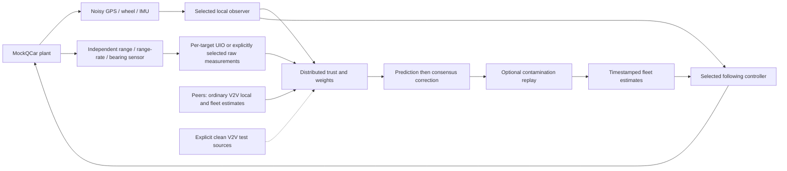

# Observer, trust and control audit — 2026-10-29

The active simulation chain is connected and has been checked at its numerical,
timing, configuration and control boundaries. This pass fixes concrete defects;
it does not establish a general stability proof or real-vehicle performance.
Clean V2V remains a valid, explicitly selectable experiment input.

## Active architecture



`fake_vehicle_real_logic.py` runs `VehicleLogic` and `VehicleObserver`, rather
than a second estimator implementation. The headless `observer_pipeline.py`
uses those runtime observers and the same plants and sensor models. Its new
`--closed-loop` option also uses the runtime CACC with simulation controller
configuration. It exercises straight longitudinal following; route planning,
lateral control, Ground Station and the complete state machine require their
own integration runs.

The local, relative and fleet factories remain the algorithm extension points.
The canonical communicated state is `[x, y, theta, velocity, acceleration]`.
Positions use metres, angles radians, time seconds or explicitly named integer
nanoseconds, and longitudinal speed/acceleration use m/s and m/s². Relative
range-rate is signed radial velocity, not the difference between two scalar
speedometers. The UIO internally uses range minus `li`; its external output
adds `li` back.

## Defects fixed

| Boundary | Finding | Change |
| --- | --- | --- |
| Local learned-trust filter | Covariance used an optimal-gain shortcut after trust altered the gain | Scalar Joseph covariance update with the actual applied gain |
| Built-in EKF | Explicit matrix inverse and subtractive covariance update | Linear solve, Joseph update and explicit symmetry restoration |
| Local selection | Unavailable selected QCarEKF could silently select the built-in implementation | Initialization raises; `use_qcar_ekf: false` explicitly selects the built-in EKF |
| Local GPS | Classical observer could repeatedly assimilate a held GPS sample | Route new GPS samples on their actual fresh ticks |
| Fleet time | Current-time measurements were corrected and advanced another step | Predict to the observation time, then correct |
| Initialization / outages | First peer sample could be advanced again; missed target time was not retained | Per-target estimate timestamps and actual elapsed prediction intervals |
| Broadcasting | Cached state was labelled with packet send time | Separate `estimate_timestamp_ns`; receiver honours estimate time |
| Controller reads | Cached fleet position could lag behind the current control tick | Use the selected predictor for read-time snapshots without advancing the cache |
| Clean / host anchoring | A current-time pose anchor was advanced by another `dt` | Apply the anchor at its own output time |
| Replay | Update order, angular residuals and final filtering could differ from live execution | Record order/filter metadata, wrap heading residuals, replay the same sequence |
| Relative UIO | Stable gains alone did not reject an unreconstructible descriptor | Check full column rank, reconstruction identity, finite parameters and Schur stability |
| Packet validity | Future fleet snapshots and non-finite/partial states could enter fusion | Age guards and atomic finite-state validation |
| Packet ordering | Arrival order could displace a newer sample | Keep bounded histories ordered by estimate timestamp |
| External measurements | Cache claimed thread safety but exposed shared mutable dictionaries | Lock updates/reads, return snapshots, retain exact integer timestamps, reject older replacement |
| Weight configuration | Two explicit flag factors were rewritten as legacy defaults | Preserve explicit factors; validate modes and numeric ranges |
| Dynamics configuration | Invalid time constants or lookup tables could survive initialization | Validate finite geometry, positive time constants, paired increasing tables and model names |
| Prediction integration | One large Euler step after an outage could be unstable | Substep by at most 50 ms and one quarter of the active lag time constant |
| Reverse prediction | Positive-only throttle lookup could turn reverse commands into zero-speed targets | Reflect the calibrated positive branch for reverse, consistently with the local simulation model |
| Runtime configuration | Child `embedded_core` settings did not reach the actual fleet factory | Forward them through the runtime configuration merge |
| Fleet configuration | Packet age/history settings were advertised but could be ignored | Forward and use configured age and bounded history limits |
| Native authority | A parity fault automatically changed backend | Stop the authoritative run; a new shadow evaluation requires explicit reset/selection |
| Basic consensus | Heading could average through zero across ±pi; update errors returned stale output | Wrap heading residuals, validate convex gains and propagate failures |
| Legacy distributed Luenberger | Missing receiver method caused every consensus update to fail silently | Use complete canonical fleet packets and their own leader-relative frame; skip absent peer evidence |
| Legacy distributed gains | Missing files or wrong dimensions selected substitute gains | Validate the configured matrices and propagate missing/invalid design errors |

The Python predictor and C++ kernel were updated together, and both native
shared and static libraries were built. Shadow mode continues to mean Python
is the selected implementation; a missing optional shadow library is reported
as unavailable. That is distinct from explicitly granted native authority,
which now stops on failure.

## Mathematical checks

### Covariance after trust changes the gain

For a scalar channel with prior variance `P`, observation variance `R`, nominal
gain `K = P/(P+R)` and trust `t`, the applied gain is `G = t K`. The update is:

```text
P_after = (1 - G)^2 P + G^2 R
```

The shortcut `(1-G)P` is generally different when `t` is between zero and one.
Analytic tests cover zero, partial and full trust. The full built-in EKF uses
the corresponding matrix Joseph expression. The general-gain covariance
formula is supported by [NASA/JPL's filtering treatment](https://tmo.jpl.nasa.gov/progress_report/42-116/116c.pdf).

This is still a diagonal, learned robust filter. Trust depends on the residual,
and the odometry anchor is correlated with the estimate. Its reported variance
has not been established as a statistically calibrated posterior covariance.
That requires held-out consistency testing, rather than only positive variance.

### Relative descriptor observer

The implemented reconstruction checks are:

```text
rank([E; Ce]) = 4
Pz E + Qz Ce = I
N = Pz Ae - K Ce
L = K + N Qz
spectral_radius(N) < 1
```

These validate the configured discrete observer construction. Forward Euler
discretization and its fixed UIO gains remain a matched design; changing `Ts`,
the dynamics or discretization requires validating/recomputing the gains.
[SciPy's discretization documentation](https://docs.scipy.org/doc/scipy/reference/generated/scipy.signal.cont2discrete.html)
distinguishes Euler and zero-order-hold discretization; they are not equivalent
gain designs.

The fourth UIO state is a lumped unknown input. Uncommunicated target
acceleration, plant mismatch and an attack can share that input direction, so
the fourth state alone cannot uniquely identify a cyberattack. Also, an ACC
longitudinal model is an approximation for arbitrary radar geometry, especially
crossing targets and sharp turns. A stable observer matrix does not remove
that modelling limitation.

### Consensus and time

At observation time `k` the live update is now:

```text
x_prior[k] = f(x_previous, target_control, elapsed_target_time)
x[k] = x_prior[k]
       + w0 residual(direct[k], x_prior[k])
       + sum_j wj residual(peer_j[k], x_prior[k])
w_self + w0 + sum_j wj = 1
```

Heading residuals use the wrapped angular difference. Randomized tests check
finite nonnegative weights and normalization. Trust-based modes also check
neighbor caps; the equal-weight ablation intentionally preserves equal weights.

Convex weights bound a single Euclidean fusion step, but do not prove network
convergence, resilience to arbitrary collusion, or closed-loop string stability.
Connectivity, delays and switching policies matter; see the
[Olfati-Saber/Murray consensus paper](https://authors.library.caltech.edu/records/t2gnt-vd720).

Timestamp alignment currently uses short constant-velocity extrapolation.
After an outage, model propagation assumes held communicated control over the
missing interval; the exact intervening target control history is unavailable.
Relative sensor latency is represented by its capture timestamp, but there is
no full out-of-sequence measurement smoother for nonlinear turns.

## Reproducible checks and measured behaviour

Run from `qcar` in the `Qcar` Python environment:

```powershell
python -m unittest simulation.test_flow_math
python -m unittest simulation.test_observer_pipeline simulation.test_reference_modes
python -m unittest electronics.test_trust_observer_native
python -m simulation.observer_pipeline --duration 12 --scenario clean
python -m simulation.observer_pipeline --duration 12 --scenario relative_dropout
python -m simulation.observer_pipeline --duration 12 --closed-loop
python -m simulation.observer_pipeline --duration 12 --closed-loop --scenario v2v_pose_bias
cmake --build electronics/native/build
```

The audit scanned 323 Python files outside the vendor/original/legacy/cache
exclusions: all parsed, with no duplicate definitions. The focused suite covers
the local robust filter, fleet initialization, trust memory, end-to-end
observer chain, clean references, analytic invariants and native parity.
All 93 focused tests passed. The final nine-scenario runtime matrix passed
shadow parity on all three vehicles with zero recorded native mismatches.
`git diff --check` also passed.

The selectable distributed Luenberger observer additionally passes a 20-step,
four-vehicle runtime smoke test with the shipped gain files, plus reference-frame
and failure-contract tests. Its gains are specific to the fleet dimension;
other fleet sizes need a compatible configured design. This smoke test is not
a tracking or robustness benchmark of that alternative observer.

Three-vehicle, 12-second estimator experiments, seed 91, independent radar/UIO
evidence and unchanged controller/trust tuning:

| Scenario | Previous fleet position RMSE | Corrected fleet position RMSE |
| --- | ---: | ---: |
| Clean | 0.01941 m | 0.01714 m |
| V2V position bias | 0.09694 m | 0.09893 m |
| Relative-sensor outage | 0.11934 m | 0.02833 m |
| Local GPS bias | 0.02168 m | 0.01919 m |
| Turning | 0.01838 m | 0.01674 m |

The V2V-attack score is slightly worse; these fixes improve consistency rather
than every scenario's tuned RMSE. With additional seeds 17 and 203, clean RMSE
was 0.01546/0.01804 m, and V2V-bias RMSE was 0.09276/0.09539 m. These are a small
deterministic sample, not a Monte Carlo robustness claim.

In 12-second longitudinal CACC runs, clean, V2V bias, GPS bias and relative
outage cases kept commands within `[-0.3, 0.3]`; the smallest true
center-to-center gap was approximately 0.662 m. The outage run requested stop
on 415 follower ticks and had larger spacing error because it stopped following
while the required leader estimate was unavailable. Center gap is a diagnostic,
not a collision-certification metric. Zero throttle requests do not imply an
instantaneous physical stop.

Raw verification output is under ignored `simulation/results/deep_audit/`.
`before.json` is the baseline, `final.json` contains the multi-seed/model checks
before native configuration forwarding, and `runtime_verified.json` records the
final active runtime with shadow comparisons enabled.

## Highest-value remaining work

| Priority | Improvement | Acceptance evidence |
| --- | --- | --- |
| 1 | Full route/lateral/state-machine closed-loop validation | Leader braking, bends, reverse gating, route loss and rejoin; gap, tracking, jerk and recovery metrics |
| 1 | Attacks present at the first peer packet | Validate initialization against independent bearing/range before allowing a remote pose to seed long-lived prediction |
| 1 | Observability-aware relative models | Compare the ACC UIO with a 2D relative observer on crossing/turning targets; preserve exact sensor provenance |
| 1 | Calibrated local uncertainty | Held-out trajectories, NIS/NEES or empirical coverage, model mismatch and multi-sensor attack recovery |
| 1 | Time-consistent delayed fusion | Capture-time host history, replayable clean-reference snapshots, explicit control histories and clock offset/jitter tests |
| 2 | Trust dynamics independent of update rate | Specify decay/EMA/recovery in seconds, then compare equal physical scenarios at different fleet rates |
| 2 | Quantified distributed robustness | Packet loss/reordering, partitions, asymmetric graphs, colluding peers, and string-stability analysis |
| 2 | Smaller runtime components | Extract prediction, source policy and replay contracts behind the existing factories, using shared golden vectors for Python/C++ |
| 2 | Strict configuration schemas across all modules | Reject unknown keys and incompatible selections, with explicit migration for legacy experiment files |
| 3 | More realistic sensing and hardware validation | Occlusion, target association, correlated noise, measured delays, hardware-in-loop and real-car datasets |

For an extension, implement the existing estimator/controller interface,
register it in the corresponding factory, define its input/frame/time contract,
validate its configuration, and add analytic plus runtime integration checks.
If replay or a native backend is supported, store every exogenous input needed
to reproduce the step and add golden-vector parity tests. Keep experiment
references selectable and labelled; keep failure separate from source or
algorithm selection.
